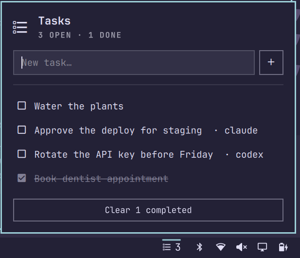

# omarchy-tasks

A tiny shared todo list for [Omarchy](https://omarchy.org/): a checklist icon in
the bar for you, a `tasks` command for your AI agents. Both work on the same list,
and changes show up live.



- Click the icon in the bar to open a panel, styled like the built-in wifi and
  bluetooth panels.
- Type a task and press **+** or Enter. Click a task to tick it off, hover to get
  an × that deletes it, and use **Clear completed** to tidy up.
- The bar icon shows how many tasks are still open.
- Agents (Claude Code, Codex, opencode, Grok, scripts, anything with a shell) use
  the `tasks` CLI. Tasks they add are tagged with their name, e.g. `· claude`.

## Install

Requires Omarchy 4 (the Quickshell-based shell), `jq`, and `flock` (util-linux).

```bash
omarchy plugin add https://github.com/Derrekito/omarchy-tasks.git --enable
ln -s ~/.config/omarchy/plugins/derrekito.tasks/bin/tasks ~/.local/bin/tasks
```

`--enable` asks which bar section to use. To move the icon later:

```bash
omarchy bar move derrekito.tasks --before omarchy.bluetooth
```

## The `tasks` CLI

```
tasks add <text...> [--by NAME]   add a task, prints its id (NAME defaults to $TASKS_BY or "human")
tasks ls [--json] [--open]        list tasks (--open hides completed)
tasks done <id>... | undo <id>... | toggle <id>... | rm <id>...
tasks clear [--all]               drop completed tasks (or everything with --all)
tasks path                        print the backing file
tasks config [ephemeral true|false]
```

`tasks ls --json` returns an array of
`{id, text, done, by, created, doneAt}`. IDs are integers and are never reused,
so an agent holding an old ID can't tick off a different task.

Every write goes through the CLI under a file lock, so the panel and any number of
agents can use the list at once. The panel uses the same CLI, and watches the
file to pick up changes made elsewhere.

## Persistent or per-session

By default the list is kept in `~/.local/state/tasks/tasks.json` and survives
logout and reboot.

To have the list last only for your desktop session instead:

```bash
tasks config ephemeral true    # list moves to $XDG_RUNTIME_DIR/tasks/
tasks config ephemeral false   # back to the persistent list
```

An ephemeral list lives in `$XDG_RUNTIME_DIR` (usually `/run/user/<uid>`), which
is cleared when your last login session ends, including at reboot. An ssh session
that's still open, or lingering enabled for your user, keeps it alive.
Switching modes doesn't move tasks: each mode has its own list, and the bar
follows the switch automatically.

The setting is stored in `~/.config/tasks/config` as `ephemeral=true|false`.
Environment variables override it for a single command: `TASKS_EPHEMERAL=1`, or
`TASKS_FILE=/path/to/list.json` to use a specific file.

## Telling your agents about it

Agents only use the list if their instructions mention it. Here's a section you
can paste into `~/.claude/CLAUDE.md`, `~/.codex/AGENTS.md`,
`~/.config/opencode/AGENTS.md`, or similar:

```markdown
## Shared task list (`tasks`)

The user has a task list in the desktop bar that they and every agent share.
Use the `tasks` CLI; never edit its JSON file directly.

    tasks add --by <your-name> "text"   # prints the new id
    tasks ls --json                     # read the list (--open: hide done)
    tasks done <id> | undo <id> | rm <id>

Use it for things that should outlive this conversation or need the user's
hands: a step only they can do (a login, a hardware action, an approval), a
follow-up you found but are not doing now, or a pointer to results waiting for
them. Keep each task one short line that makes sense without this chat.

Do not mirror your internal step-by-step plan into it. Mark tasks you add done
when you finish them, and leave the user's own tasks (`by: human`) alone unless
asked.
```

## Notes

- The plugin ID is `derrekito.tasks`. Omarchy names user plugins `<owner>.<name>`.
- If you edit `Panel.qml` and the bar doesn't change, run `omarchy restart shell`.
  The shell's hot reload can keep the old widget cached.
- Keyboard: the text box is focused when the panel opens; Esc closes it.

## License

MIT
